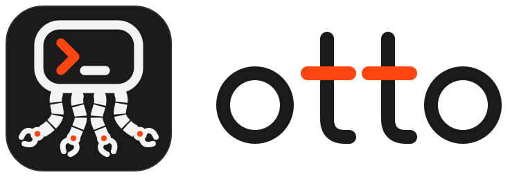

<p align="center">
  <picture>
    <source media="(prefers-color-scheme: dark)" srcset="Resources/branding/otto/otto-lockup-on-dark.svg">
    
  </picture>
</p>

<p align="center">
  <b>Let coding agents see and operate desktop apps, on macOS and Linux.</b><br>
  Plus iOS Simulators and Android emulators and phones, with the same commands.
</p>

Otto gives coding agents (Claude Code, Codex, Cursor, Gemini CLI, opencode, pi and others) the
apps on your computer: each window's element tree with click points, screenshots, clicks
and taps, typing, menus, windows and tray icons. It runs on **macOS** and on **Linux**
desktops (GNOME, KDE Plasma and Sway), as one CLI and one MCP server, so an agent that
knows it on one uses it unchanged on the other.

Agents work through accessibility first, so your cursor stays put. When they have to, they use
the real mouse and keyboard behind guard rails, and you can stop them at any moment.

https://github.com/user-attachments/assets/bc87ab18-c768-4d3e-85a3-fe866112ebc8

<sub>A scripted agent reads Calculator's element tree and works out 7 × 6, types into a
TextEdit window behind another one, double-clicks with the real mouse, searches Wikipedia in
Safari, and stops when the user presses ⌃⌥⌘.</sub>

| | macOS | Linux |
|---|---|---|
| Runs on | macOS 15 or later, Apple silicon and Intel | GNOME, KDE Plasma, Sway and other wlroots desktops under Wayland, x86_64 and arm64 |
| Reads apps through | Accessibility | AT-SPI, the desktop's accessibility bus |
| Also drives | iOS Simulators, Android emulators and phones | Android emulators and phones |
| Lives in | the menu bar | the tray, with the same Control Tower panel |
| Stop agents with | **⌃⌥⌘.** | **Ctrl+Alt+Super+.** |
| Install | Homebrew cask | `.deb`, `.rpm`, tarball or Homebrew formula |

Otto was called macOS Harness before 2.0.
[What changes when you upgrade](docs/getting-started.md#coming-from-macos-harness-1x).

## Install

### macOS

```bash
brew install --cask therogue76/tap/otto-harness
otto doctor
```

The **Otto** menu bar app opens a setup window: turn on Accessibility and Screen Recording
for it, then choose **Restart Helper** from its menu. Run `doctor` again until everything is
green. To upgrade, refresh the tap first: `brew update && brew upgrade --cask otto-harness`.
Keep the `--cask`: without it, Homebrew picks the Linux formula of the same name.

### Linux

Download the package for your distribution from the
[latest release](https://github.com/TheRogue76/otto-harness/releases), or use Homebrew:

```bash
sudo apt install ./otto-harness_*_amd64.deb      # Ubuntu 24.04 or later, Debian 13
sudo dnf install ./otto-harness-*.x86_64.rpm     # Fedora
brew install therogue76/tap/otto-harness          # Homebrew on Linux
otto permissions grant
```

Elsewhere, unpack the tarball and run its `install.sh`. `permissions grant` says before each
step what your desktop will ask: Sway asks nothing, KDE asks once each for screenshots and
input, and GNOME also installs Otto's Shell extension. See [Linux](docs/linux.md).

## Connect your agent

```bash
otto setup claude
```

`setup` shows what it will change and asks first. Use `codex`, `cursor`, `gemini` or
`opencode` for those agents, or `pi` to install the skill for pi; `otto setup` alone shows
what's connected. All but pi get an MCP server; pi and any other shell-based agent use the
CLI directly. The first time each agent uses Otto, you're asked to allow it, once.

## What agents can do

- **See** any app's windows as an element tree with click points, screenshots of one
  window, menus, menu bar extras and tray icons, and only what changed since the last look.
- **Act** through accessibility (press, type, set values, choose menu items) without
  touching your cursor, and with the real mouse and keyboard only when nothing else works.
  On the Mac, clicks and scrolls can also go to a window in the background. Every action
  reports what changed.
- **Read what the tree can't** with text recognition, and **record** what happened as a
  movie.
- **Drive Android** emulators and phones on both platforms and **iOS Simulators** on the
  Mac with the same commands, and build and run iOS and Mac apps with `build`.
- **Repeat checks** as YAML flows, export an agent's session as one, and run them in CI on
  macOS and Linux runners.
- **Stay in your control**: one approval per agent, a stop button and shortcut, real input
  that waits for you and stops when you move, a policy file to block apps, and a journal of
  everything agents asked for. It makes no network connections.

## Guides

- [Getting started](docs/getting-started.md): install, permissions, pairing, first
  commands, and every command at a glance
- [Linux](docs/linux.md): installing on GNOME, KDE Plasma and Sway, and what differs there
- [Flows](docs/flows.md): repeatable UI checks, exporting sessions, CI
- [iOS Simulators](docs/ios-simulators.md) and [Android](docs/android.md)
- [Unattended runs](docs/unattended.md): agents on a schedule, with nobody watching
- [Staying in control](docs/security-model.md): pairing, stops, the policy file, the
  journal, and what isn't a security boundary
- [Troubleshooting](docs/troubleshooting.md) and [known limitations](docs/limitations.md)
- Reference: [CLI](docs/reference/cli.md), [MCP tools](docs/reference/mcp.md), and the
  [interface contract](knowledge/design/interface-contract.md) for what stays stable
  across versions

## Contributing

[CONTRIBUTING.md](CONTRIBUTING.md) covers building from source, testing and the code style;
[SECURITY.md](SECURITY.md) how to report a vulnerability. Design notes, research and the
roadmap are in [knowledge/](knowledge/index.md). Agents working in this repo: read
[AGENTS.md](AGENTS.md) first.

## License

[MIT](LICENSE)
